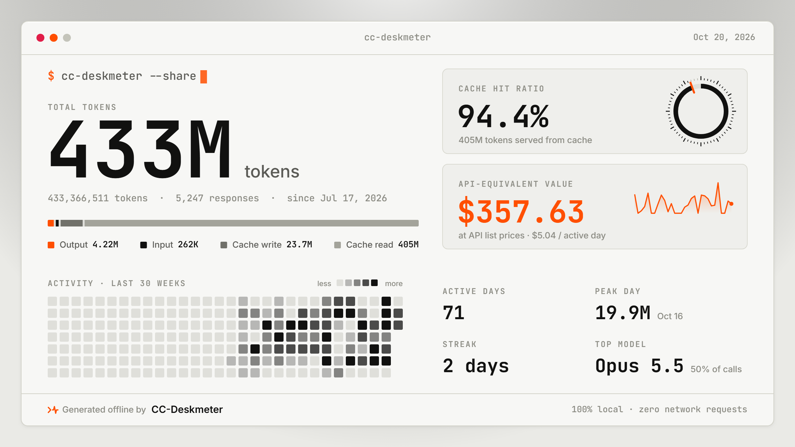
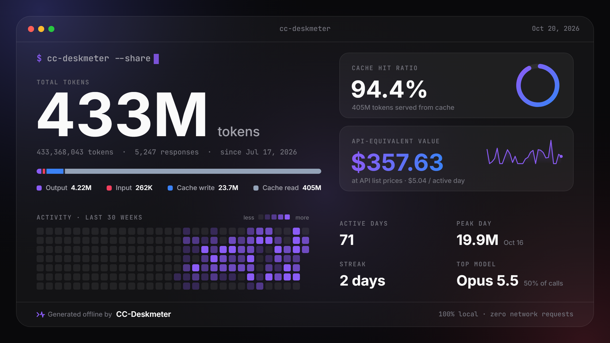

# CC-Deskmeter

**Real-time token, cost & weekly-limit HUD for Claude Code Desktop. 100% offline.**

Brings back the token chart that newer Claude Code Desktop builds dropped, and sees the weekly limit coming: 
5-hour window countdown, burn rate, cache hit ratio, API-equivalent cost and a weekly-limit forecast, all read from files already on your computer.

  
  
  
  
  
  
  

**English** · [简体中文](README.zh-CN.md)

---

## Download

Grab the installer for your system from the [latest release](https://github.com/shyrel666/cc-deskmeter/releases/latest):

| OS | File |
|---|---|
| Windows 10/11 (x64) | `*_x64-setup.exe` |
| macOS (Apple Silicon + Intel) | `*_universal.dmg` |
| Linux (x64) | `.AppImage`, `.deb` or `.rpm` |

> [!NOTE]
> The installers are not code-signed yet.
> **Windows:** if SmartScreen appears, click **More info → Run anyway**.
> **macOS:** if the app "is damaged", move it to Applications and run `xattr -cr /Applications/cc-deskmeter.app` once.

## Why CC-Deskmeter

Newer Claude Code Desktop builds no longer show token usage, so you code without knowing how much of your 5-hour window is left, how fast you're burning it, when the weekly limit will run out, or whether caching is working. CC-Deskmeter puts those answers in a small window you can keep in the corner of your screen. The Claude Code CLI writes the same transcripts, so terminal sessions count too.

- **100% offline.** No account, API key or network access: it only reads files Claude Code Desktop already keeps on your computer, plus a small [history archive](#history-archive) of its own.
- **The token chart, back.** Stacked input, output, cache write and cache read for the current block, 14 days or months, plus a per-project leaderboard.
- **5-hour window at a glance.** Countdown to reset, burn rate in tokens/min and $/hour, and a projected block total learned from how your past windows went on.
- **Weekly limit, ahead of time.** When your current pace hits the weekly limit and how that compares with the reset, a daily budget until then, and which projects and models used it. Needs Claude Desktop on the same computer.
- **Cache reads, one click away.** Strip the huge cache-read volume out of the chart so the rest of your usage stays readable.
- **Mini HUD.** A 320×140 frameless, always-on-top widget that updates with every response.
- **Numbers in the tray.** Hover the tray icon on Windows for the reset countdown, predicted quota, burn rate and today's total, or right-click it for a compact panel in the app's theme. On macOS the menu bar shows the quota and countdown beside the icon; pick either one, or the icon alone, from its menu. Closing the window can minimize it to the tray, where tracking carries on.
- **Three themes.** *Claude Warm*, *Swiss Dial* and *Glass Bento*.
- **Share card.** Export a 2400×1350 stats card with your totals, cache hit ratio and API-equivalent value. It contains totals only.

## Screenshots

<table>
  <tr>
    <td width="50%"></td>
    <td width="50%"></td>
  </tr>
  <tr>
    <td align="center">Swiss Dial</td>
    <td align="center">Glass Bento</td>
  </tr>
</table>

### Mini HUD

<table>
  <tr>
    <td></td>
    <td></td>
    <td></td>
  </tr>
</table>

Press <kbd>M</kbd> to shrink the dashboard into an always-on-top widget, and press it again to restore it.

### Share card

<table>
  <tr>
    <td width="50%"></td>
    <td width="50%"></td>
  </tr>
</table>

Drawn locally and copied or saved as PNG, in English or Chinese. It never shows project names, paths or prompts.

## Keyboard shortcuts

| Key | Action |
|---|---|
| <kbd>M</kbd> | Toggle the Mini HUD |
| <kbd>A</kbd> | Open the archive & lifetime view |
| <kbd>R</kbd> | Rescan transcripts |
| <kbd>T</kbd> | Cycle themes |
| <kbd>L</kbd> | Switch between English and 中文 |
| <kbd>Alt</kbd>/<kbd>⌥</kbd> + <kbd>1</kbd> <kbd>2</kbd> <kbd>3</kbd> | Claude Warm / Swiss Dial / Glass Bento |
| <kbd>Esc</kbd> | Close the open dialog |

## Star history

## License

[MIT](LICENSE). "Claude" is a trademark of Anthropic, PBC; this project is not affiliated with or endorsed by Anthropic. 
