


# CC-Deskmeter

**Real-time token, cost & limit HUD for Claude Code and ChatGPT. 100% offline.**

Brings back the token chart Claude Code Desktop dropped, shows ChatGPT's limits for every account you sign in with, 
and tells you when the 5-hour window resets and when the weekly limit runs out, all from logs already on your computer.

  
  
  
  
  
  
  

**English** · [简体中文](README.zh-CN.md)

[Download](#download) · [Features](#features) · [Screenshots](#screenshots) · [Shortcuts](#keyboard-shortcuts)
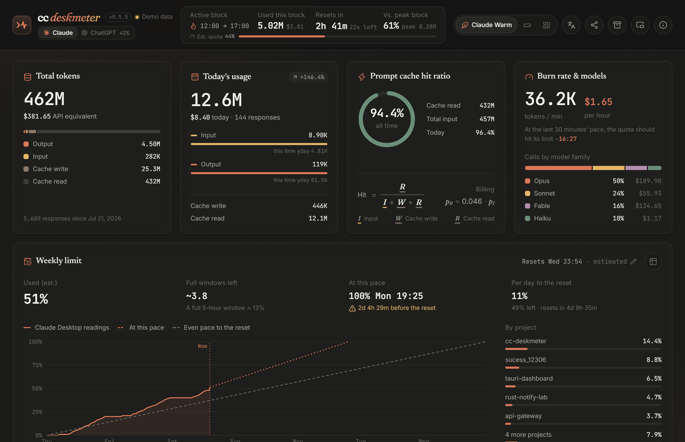

> [!TIP]
> **New in v0.5.5: ChatGPT.** Press <kbd>C</kbd> to switch to a dashboard built for ChatGPT: the 5-hour and weekly limits of every account, reasoning effort, context and subagents, and every thread. The Mini HUD and the tray can show both tools at once.

## Download

Grab the installer for your system from the [latest release](https://github.com/shyrel666/cc-deskmeter/releases/latest):

| OS | File |
|---|---|
| Windows 10/11 (x64) | `*_x64-setup.exe` |
| macOS (Apple Silicon + Intel) | `*_universal.dmg` |
| Linux (x64) | `.AppImage`, `.deb` or `.rpm` |

> [!NOTE]
> The installers are not code-signed yet.
> **Windows:** if SmartScreen appears, click **More info → Run anyway**.
> **macOS:** if the app "is damaged", move it to Applications and run `xattr -cr /Applications/cc-deskmeter.app` once.

Open it and it starts reading right away: no account, API key or setup.

## Two tools, one HUD

Newer Claude Code Desktop builds no longer show token usage, and neither tool tells you how fast you're burning through your limits. CC-Deskmeter answers both in a small window you can keep in the corner of your screen. <kbd>C</kbd> switches between the tools, and each view is built around what its logs can tell.

| | Claude Code | ChatGPT |
|---|---|---|
| **Reads** | Claude Code transcripts, from Desktop and the CLI | ChatGPT's session logs, compressed ones included |
| **5-hour window** | Countdown, burn rate, projected total, estimated quota | Usage and reset time for each account, as ChatGPT logs them |
| **Weekly limit** | Forecast from Claude Desktop's readings: when it runs out, a daily budget, who used it | Usage per account, when it fills at this pace, 7-day trend |
| **Accounts** | Follows the account signed in to Claude Desktop | Every account, named after its sign-in email, renameable |
| **Breakdown** | Projects & sessions, model families | Threads, models, reasoning effort, context & subagents |
| **Cost** | Anthropic API list prices | OpenAI Standard API prices |

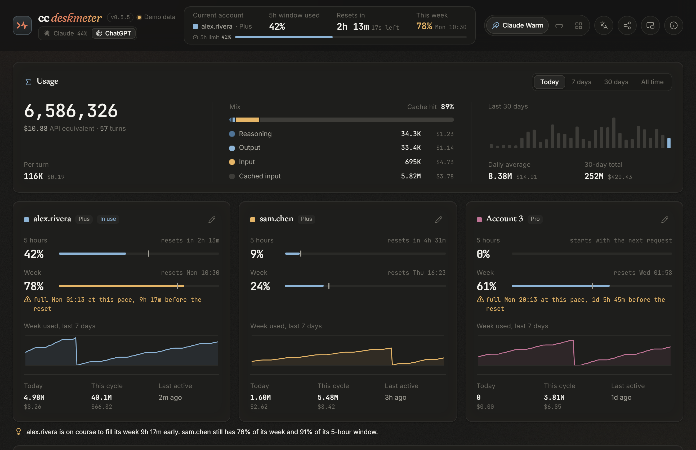

## Features

### Claude Code

- **The token chart, back.** Stacked input, output, cache write and cache read for the current block, 14 days or months. One click strips the huge cache-read volume out so the rest stays readable.
- **5-hour window at a glance.** Countdown to the reset (aligned the way Claude aligns it), burn rate in tokens/min and $/hour, and a projected block total learned from how your past windows went on.
- **Weekly limit, ahead of time.** When your pace reaches 100% and how that compares with the reset, a daily budget until then, full 5-hour windows left, and which projects and models used it. Needs Claude Desktop on the same computer.
- **Projects & sessions.** A leaderboard of which project folders use the most, sorted by tokens, cost or recency.
- **History that outlives transcripts.** Claude Code deletes transcripts after 30 days by default; CC-Deskmeter keeps daily, 5-hour block and weekly summaries. Press <kbd>A</kbd> for lifetime totals, the busiest day and block, streaks and months.
- **Account switches handled.** The active block and the weekly estimate count only the account signed in now, so switching never carries usage over.
- **Terminal sessions count too.** The Claude Code CLI writes the same transcripts as Desktop.

### ChatGPT

- **Tokens first.** Today, 7 days, 30 days or all time, split into reasoning, output, input and cached input, with the API-equivalent cost beside each figure.
- **Every account's limits.** 5-hour and weekly usage, reset times, when the week fills at the current pace and a 7-day trend, for each account you use, with a one-line hint of which one still has room.
- **Trend chart.** Tokens or cost over 30 days or today, split by account, token type or model, with cached input hidden at a click.
- **Where the week went.** Models with their context windows, reasoning effort levels, near-full contexts, compactions and the share spent in subagents.
- **Thread board.** Every thread of the last 7 days with its account, model and effort, turns, tokens, cost and context peak, filterable by account.

### Everywhere

- **Mini HUD.** A frameless, always-on-top widget that updates with every response: one tool at 320×140, or both stacked at 320×120.
- **Numbers in the tray.** On Windows, hover the tray icon for the reset countdown, quota, burn rate and today's total, or right-click it for a compact panel in the app's theme. On macOS the menu bar shows the quota and countdown beside the icon. ChatGPT joins Claude there once it has sessions. Closing the window can minimize it to the tray, where tracking carries on.
- **Three themes.** *Claude Warm*, *Swiss Dial* and *Glass Bento*, with an accent of its own for each tool.
- **Share cards.** A 2400×1350 card for either tool, with total tokens, cache hit ratio, API-equivalent value and an activity heatmap, in English or Chinese. Totals only: no project names, thread names, paths or accounts.
- **Custom prices.** Add or override model prices in a local file, no new build needed ([how](#custom-prices)).
- **English and 中文**, switched with <kbd>L</kbd>.

## Screenshots

<table>
  <tr>
    <th></th>
    <th width="48%">Swiss Dial</th>
    <th width="48%">Glass Bento</th>
  </tr>
  <tr>
    <th>Claude</th>
    <td>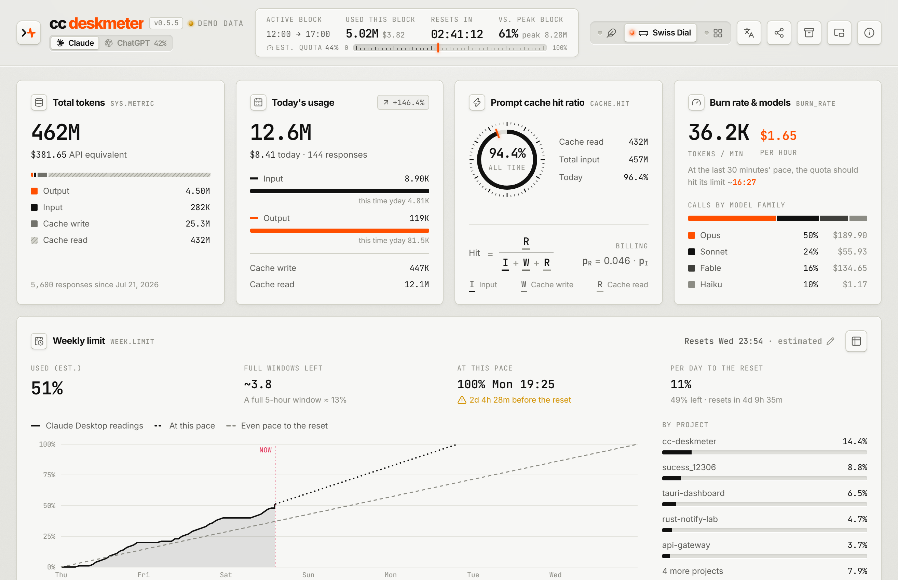</td>
    <td>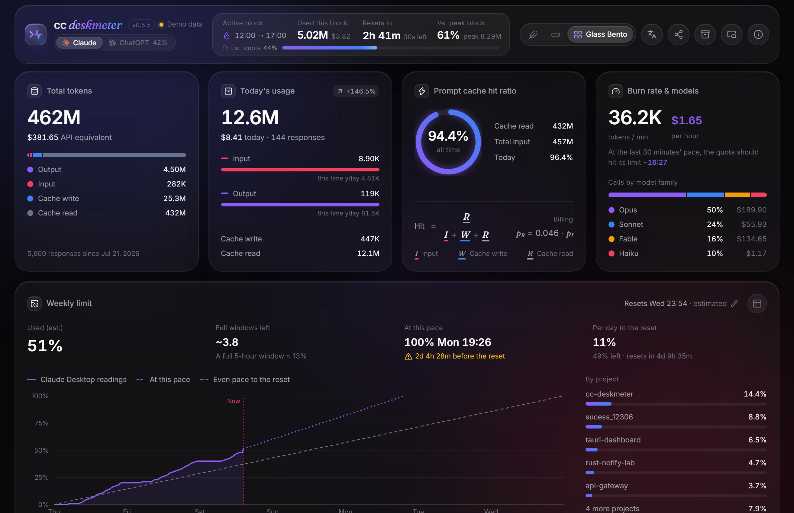</td>
  </tr>
  <tr>
    <th>ChatGPT</th>
    <td>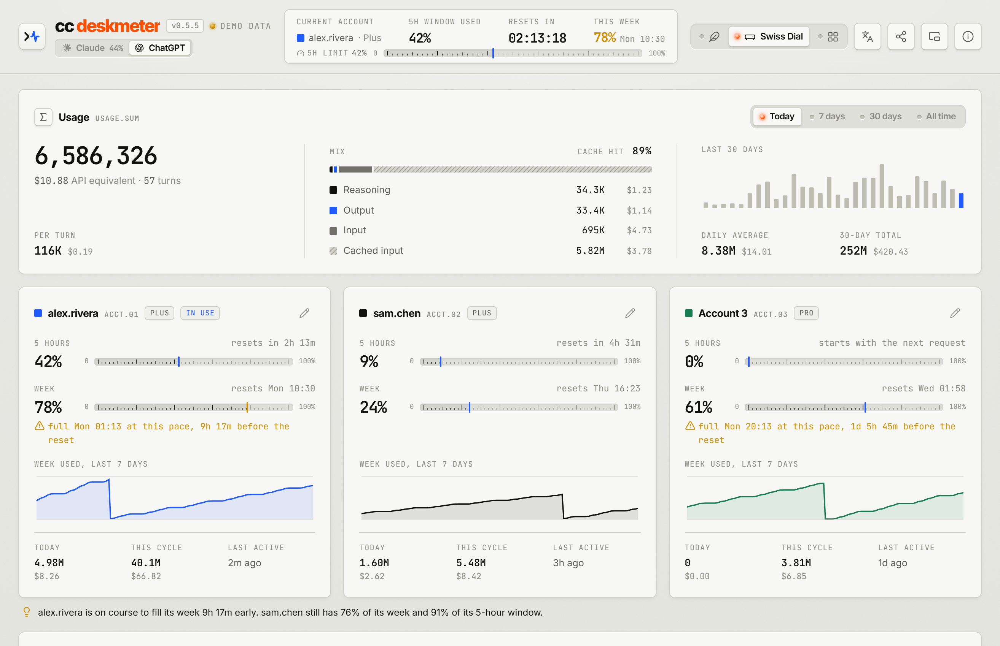</td>
    <td>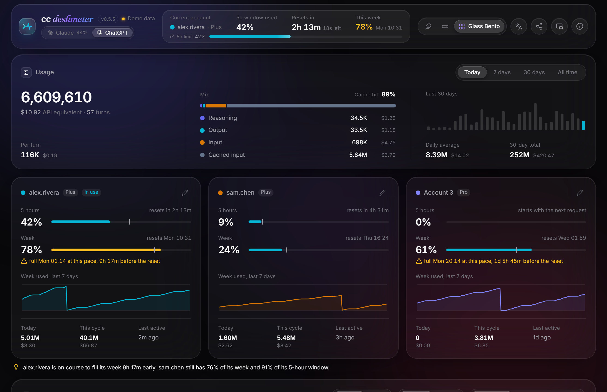</td>
  </tr>
</table>

### Mini HUD

<table>
  <tr>
    <td>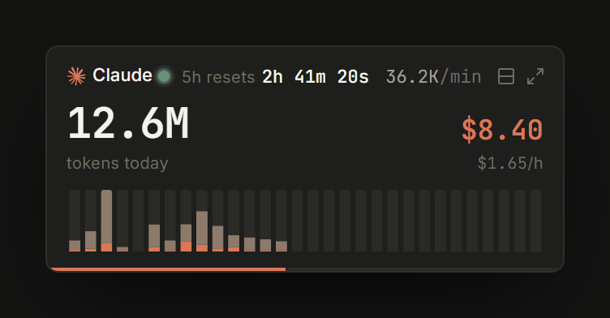</td>
    <td>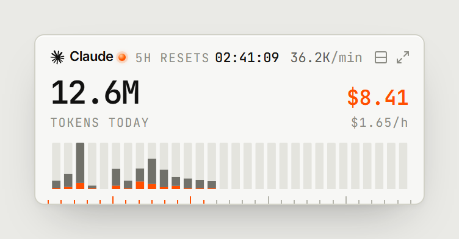</td>
    <td>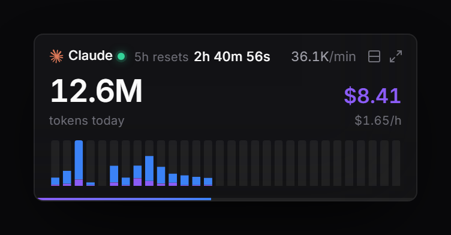</td>
  </tr>
  <tr>
    <td>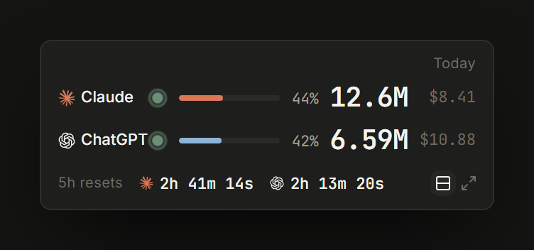</td>
    <td>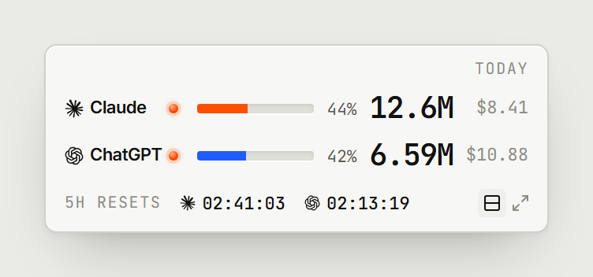</td>
    <td>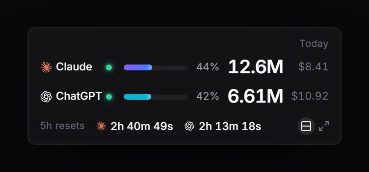</td>
  </tr>
</table>

Press <kbd>M</kbd> to shrink the dashboard into an always-on-top widget, and press it again to restore it. In the widget, <kbd>C</kbd> switches tools and the layout button stacks both.

### Share cards

<table>
  <tr>
    <td width="50%">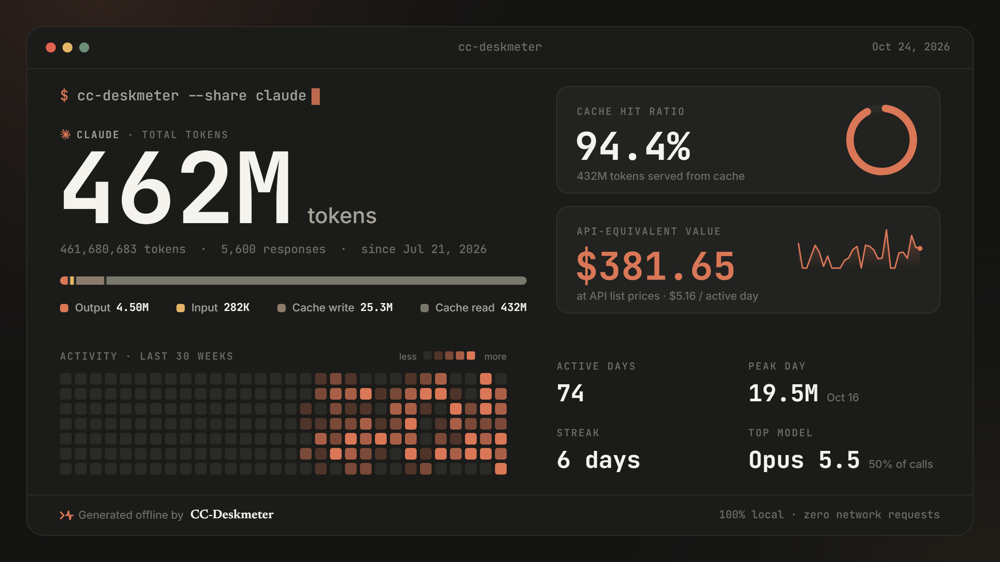</td>
    <td width="50%">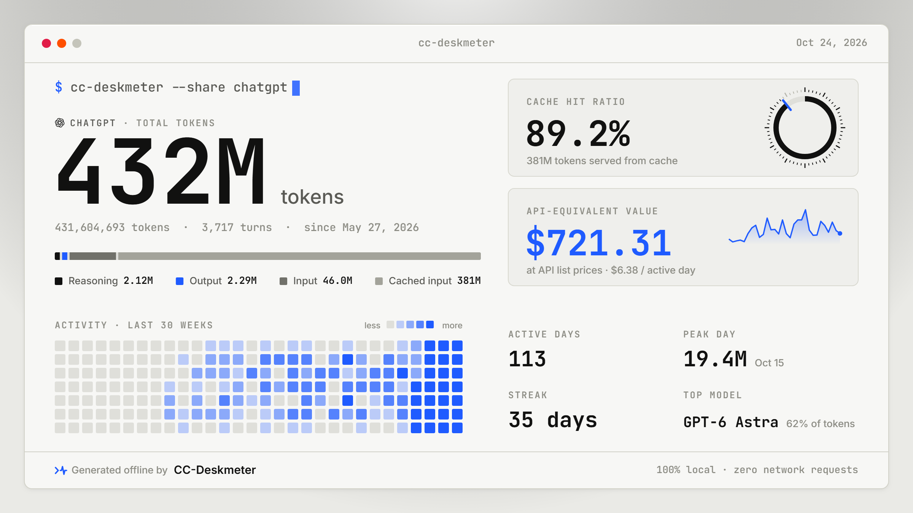</td>
  </tr>
  <tr>
    <td align="center">Claude · Claude Warm</td>
    <td align="center">ChatGPT · Swiss Dial</td>
  </tr>
</table>

Drawn on your computer and copied or saved as PNG. The card follows the app's theme and the tool on screen.

## Keyboard shortcuts

| Key | Action |
|---|---|
| <kbd>C</kbd> | Switch between Claude and ChatGPT |
| <kbd>M</kbd> | Toggle the Mini HUD |
| <kbd>A</kbd> | Open the archive & lifetime view (Claude) |
| <kbd>R</kbd> | Rescan the logs |
| <kbd>T</kbd> | Cycle themes |
| <kbd>L</kbd> | Switch between English and 中文 |
| <kbd>Alt</kbd>/<kbd>⌥</kbd> + <kbd>1</kbd> <kbd>2</kbd> <kbd>3</kbd> | Claude Warm / Swiss Dial / Glass Bento |
| <kbd>Esc</kbd> | Close the open dialog |

## Star history

## License

[MIT](LICENSE) · © 2026 cc-deskmeter. "Claude" is a trademark of Anthropic, PBC and "ChatGPT" a trademark of OpenAI; this project is not affiliated with or endorsed by either.
